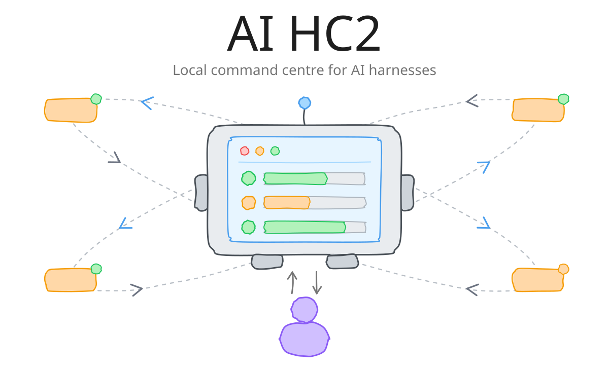
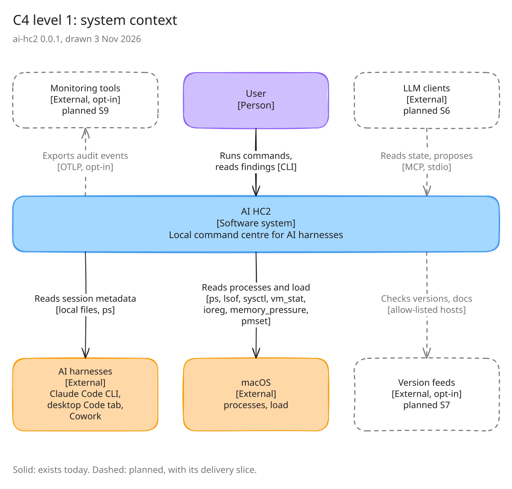
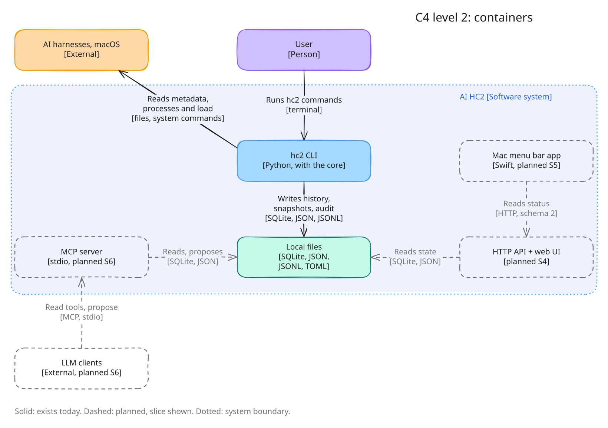
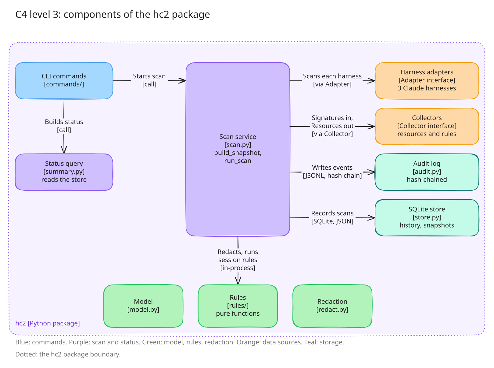

# AI HC2



*The picture shows the aim. The grey arrows are what 0.0.1 does: it reads from the harnesses, and you run commands and read the findings. The blue arrows, from HC2 back to the harnesses, are planned (slice S6).*

**A local command centre that shows what the AI tools on your machine are doing.**

AI HC2 (AI Harness Command Center) gives a developer one place to look at their AI harnesses. A harness is a tool that runs an AI agent or chat, such as Claude Code. HC2 takes only metadata from each harness's local files, never the content of your conversations, and tells you in plain English what is running, what is using your memory and what needs fixing.

## Status

**Pre-alpha: version 0.0.1. Read-only.** HC2 looks and suggests. It never stops a process or changes a setting.

- **Harnesses:** the Claude Code CLI, the Claude desktop Code tab and Cowork. No others yet.
- **System:** macOS first. Linux comes later.
- **Interface:** the command line. There is no web dashboard, Mac app or MCP server yet.
- **Stability:** expect breaking changes.

See [what is planned](#planned) and the [delivery slices](docs/slices.md) for the order in which features arrive.

## What it shows today

| You want to know | Command | What you get |
|---|---|---|
| Which sessions are there? | `hc2 sessions` | Every session found, running or ended, with its harness, state, last activity, model, title and folder. Use `--state` to filter. |
| What is using memory and CPU? | `hc2 resources` | Memory pressure, swap, load and heat, the biggest process trees, and any findings. |
| What needs fixing? | `hc2 status` | An overall level (green, amber or red) and findings, each with a plain-English title and a suggested fix. |
| Is anything installed? | `hc2 status` | Whether each harness is installed, with its running and stale session counts. |
| Is HC2 set up? | `hc2 doctor` | A check of the Python version and of HC2's config and state folders. |
| Want a fresh scan? | `hc2 scan` | Reads everything again, stores the result and prints the status. |

HC2 cannot tell whether a Cowork session is running, so open Cowork sessions show as unknown.

`status` and `sessions` show the latest stored scan. If there is none, they scan first. `resources` takes a fresh reading each time and stores nothing. It uses the built-in thresholds and leaves out the two session rules (idle sessions and busy but quiet), which only `scan` applies, together with your config. HC2 records each installed harness's version in the stored scan, but no command shows it yet.

The findings come from rules that are plain code, not an LLM. The resource rules cover memory pressure, idle sessions that hold memory, sessions that look busy but are quiet, leftover processes, several test jobs at once, duplicate MCP servers, runaway child processes and oversized app renderers. Other findings flag a harness HC2 could not read, an invalid or changed config, and a damaged audit log.

## Quick start

You need Python 3.11 or later. HC2 has no runtime dependencies, so there is nothing to install.

```sh
git clone https://github.com/dao-wolf/ai-hc2.git
cd ai-hc2
PYTHONPATH=src python3 -m hc2 doctor
PYTHONPATH=src python3 -m hc2 scan
PYTHONPATH=src python3 -m hc2 --version
```

A scan reads metadata from the harnesses' own folders, the process list and a few read-only system commands. It writes its results only to HC2's state folder (see [Where HC2 keeps its files](#where-hc2-keeps-its-files)).

Every command takes `--json`, before or after the command name, and then prints one JSON object instead of text. To get an `hc2` command on your path, run `pip install -e .` inside a virtual environment.

Run the checks (tests, byte-compile and the privacy gate):

```sh
make check
```

### Example output

All values here are made up. This is what `doctor` prints once both folders exist:

```text
AI HC2 doctor (version 0.0.1)
  OK    Python 3.12.0 is new enough (3.11 or later).
  OK    The config folder exists: ~/.config/ai-hc2
  OK    The state folder exists: ~/.local/state/ai-hc2
Everything looks fine.
```

On a new machine, `doctor` shows a NOTE for a folder that does not exist yet. A scan creates the state folder. You only need the config folder if you add a config file, and you create it yourself.

And this is `status`, which lists every harness it checks:

```text
AI HC2 status, from the scan at 2026-11-18T09:30:00Z (took 0.2 seconds)
Overall: AMBER. Something needs a look.
Findings: 0 red, 1 amber, 0 info, 0 acknowledged.
Since the scan before: 1 new finding, 0 findings fixed.
  New: [AMBER] A leftover node process is still running on port 3000
Findings to look at:
  1. [AMBER] A leftover node process is still running on port 3000
     Fix: Suggested action: check what it is for and stop it from a terminal if you no longer need it, especially if nothing should use port 3000. HC2 only suggests this. It never stops anything itself.
Harnesses:
  Claude Code (CLI) (claude-code-cli): installed, 2 running, 1 stale
  Claude desktop (Code tab) (claude-desktop-code): not installed, 0 running, 0 stale
  Claude desktop (Cowork) (claude-desktop-cowork): not installed, 0 running, 0 stale
```

## Principles

1. **Deterministic first.** Plain code gathers, analyses and displays the data. The same inputs give the same outputs. No LLM runs inside a scan.
2. **Local only.** Version 0.0.1 makes no network calls and opens no port. Anything later that uses the network will be opt-in, and any server will bind to 127.0.0.1 only.
3. **Metadata only.** HC2 keeps only metadata fields, such as a session's folder, times, title and model. Every read is bounded: Claude Code transcripts are read only at their first 64 KB and last 256 KB, and from the desktop and Cowork session files only the listed fields are kept. Everything else is dropped in memory, so message text is never stored, shown or sent. Confidential folders are masked, and secrets are redacted before a scan is stored or shown.
4. **A person decides.** Today HC2 only reads and suggests. When actions arrive, rules, LLMs and people will be able to propose them, and only a person will approve them. Each scan is written to a local audit log.

## Architecture

Three [C4](https://c4model.com) views of version 0.0.1. Solid boxes exist today. Dashed boxes are planned, labelled with the [slice](docs/slices.md) that delivers them. Dotted lines mark a boundary.

**System context:** who uses HC2, and what it reads and talks to.



**Containers:** the parts that run, and the local files they share.



**Components:** inside the `hc2` package. Each harness plugs in through one interface, the `Adapter` protocol. The process and system readers plug in through another, the `Collector` function. The rules are pure functions from collected facts to findings. One command, `hc2 resources`, skips the scan service and calls the collectors and rules directly. That path is not drawn.



Each image has an editable `.excalidraw` source beside it in [docs/architecture](docs/architecture). Open it at [excalidraw.com](https://excalidraw.com), and export a new SVG when you change it.

## Where HC2 keeps its files

| What | Default | Override |
|---|---|---|
| Config | `~/.config/ai-hc2` | `HC2_CONFIG_DIR` |
| State | `~/.local/state/ai-hc2` | `HC2_STATE_DIR` |

The config folder holds an optional `config.toml`. Copy [`examples/config.toml`](examples/config.toml) to start. Its values are made up, and some of its options are planned: HC2 does not read them yet. The state folder holds the scan history, the snapshots and the audit log.

## Planned

Nothing here is in version 0.0.1, and the order may change. The [slices](docs/slices.md) have the detail.

- **Steering:** proposed actions that a person approves, and an MCP server so LLM clients can read state and propose actions (slice S6).
- **More ways to look:** a read-only web dashboard (S4) and a Mac menu bar app (S5).
- **Setup health:** checks that your harness setup is sound (S3), and latest-version checks (S7).
- **More harnesses:** Codex, pi, Hermes, Ollama, LM Studio and others (S8).
- **Telemetry:** exporting the audit log to monitoring tools, only when you switch it on (S9).

## Documentation

- [Requirements](docs/requirements.md)
- [Design](docs/design.md)
- [Delivery slices](docs/slices.md)
- [Local API (schema 2), planned](docs/api.md)
- [Decision records](docs/adr)
- [Threat model](docs/threat-model.md)
- [Harness data sources](docs/harnesses/sources.md)
- [Research notes on telemetry and tooling](docs/research/telemetry-and-tooling.md)

## Contributing and security

Read [CONTRIBUTING.md](CONTRIBUTING.md) first. To report a vulnerability, follow [SECURITY.md](SECURITY.md). Everyone taking part is expected to follow the [code of conduct](CODE_OF_CONDUCT.md).

## Licence

Apache-2.0. See [LICENSE](LICENSE).
