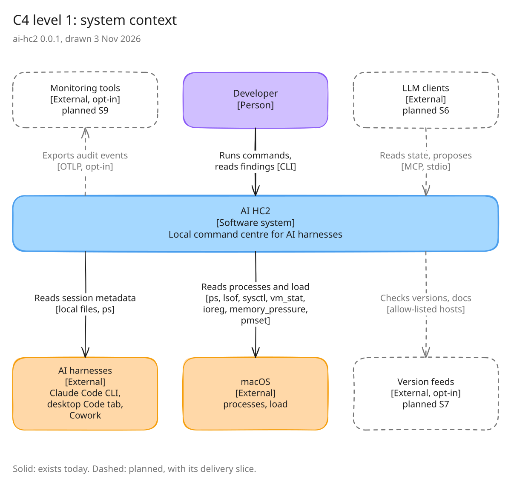
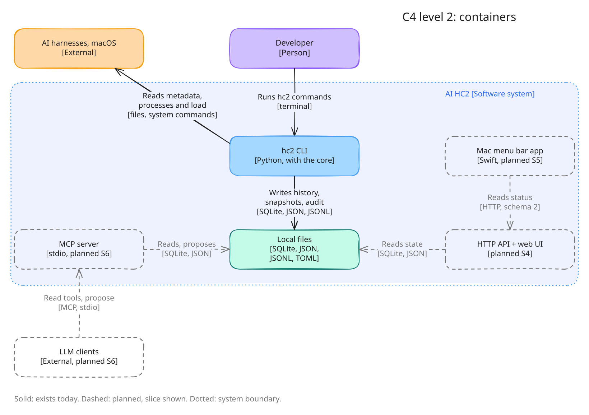
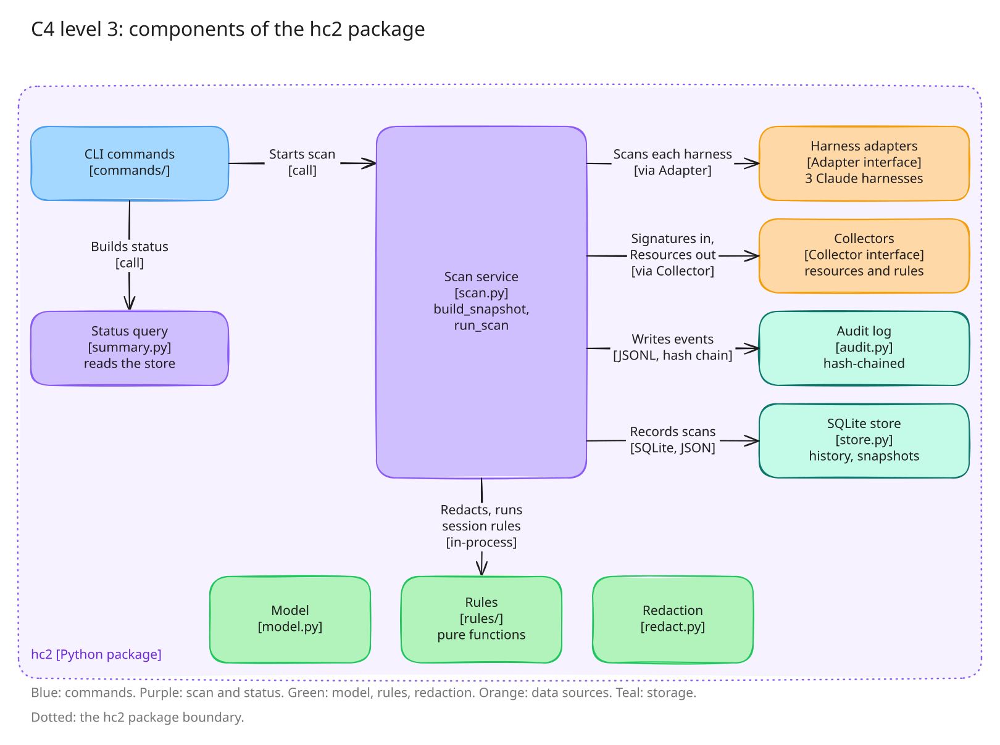

# AI HC2

AI HC2 (AI Harness Command Center) is one local place to see and steer every AI harness on a developer's machine. A harness is a tool that runs an AI agent or chat, such as Claude Code, Codex or pi.

- **What's installed:** each harness's version, and how healthy its setup is.
- **What's running:** sessions, models, processes and the resources they hold.
- **What to fix:** findings with a plain-English reason and a fix.

**Status: pre-alpha.** Version 0.0.1 works from the command line for the Claude harnesses: the Claude Code CLI, the desktop Code tab and Cowork. `hc2 scan` stores a snapshot; `status`, `sessions` and `resources` show the state, sessions, process trees and findings; `doctor` checks the setup. There is no web dashboard, Mac app or MCP server yet. Expect breaking changes. See the [slices](docs/slices.md) for what ships when.

## Principles

1. **Deterministic first.** Plain code gathers, analyses and displays the data. The same inputs give the same outputs. No LLM runs inside a scan.
2. **Local only.** Every listener binds to 127.0.0.1. Nothing is sent anywhere by default, and any network use is opt-in.
3. **Metadata only.** HC2 never reads conversation content. Confidential folders are masked, and secrets are redacted before data leaves the core.
4. **Propose, then a human approves.** Rules, LLMs and people can propose actions. Only a person approves them. Every step is logged.

## Architecture

Three [C4](https://c4model.com) views of version 0.0.1. Solid boxes exist today. Dashed boxes are planned, labelled with the [slice](docs/slices.md) that delivers them. Dotted lines mark a boundary.

**System context:** who uses HC2, and what it reads and talks to.



**Containers:** the parts that run, and the local files they share.



**Components:** inside the `hc2` package. Each harness plugs in through one interface, the `Adapter` protocol. The process and system readers plug in through another, the `Collector` function. The rules are pure functions from collected facts to findings.



Each image has an editable `.excalidraw` source beside it in [docs/architecture](docs/architecture). Open it at [excalidraw.com](https://excalidraw.com), and export a new SVG when you change it.

## Quick start

You need Python 3.11 or later. HC2 has no runtime dependencies.

```sh
git clone <this-repo-url> ai-hc2
cd ai-hc2
PYTHONPATH=src python3 -m hc2 doctor
PYTHONPATH=src python3 -m hc2 --version
```

Every command takes `--json`. To get an `hc2` command on your path, run `pip install -e .` inside a virtual environment.

Run the checks:

```sh
make check
```

## Where HC2 keeps its files

| What | Default | Override |
|---|---|---|
| Config | `~/.config/ai-hc2` | `HC2_CONFIG_DIR` |
| State | `~/.local/state/ai-hc2` | `HC2_STATE_DIR` |

See [`examples/config.toml`](examples/config.toml) for the planned options.

## Documentation

- [Requirements](docs/requirements.md)
- [Design](docs/design.md)
- [Delivery slices](docs/slices.md)
- [Local API (schema 2)](docs/api.md)
- [Decision records](docs/adr/0001-founding-decisions.md)
- [Threat model](docs/threat-model.md)
- [Harness data sources](docs/harnesses/sources.md)
- [Research notes on telemetry and tooling](docs/research/telemetry-and-tooling.md)

## Contributing and security

Read [CONTRIBUTING.md](CONTRIBUTING.md) first. To report a vulnerability, follow [SECURITY.md](SECURITY.md). Everyone taking part is expected to follow the [code of conduct](CODE_OF_CONDUCT.md).

## Licence

Apache-2.0. See [LICENSE](LICENSE).
