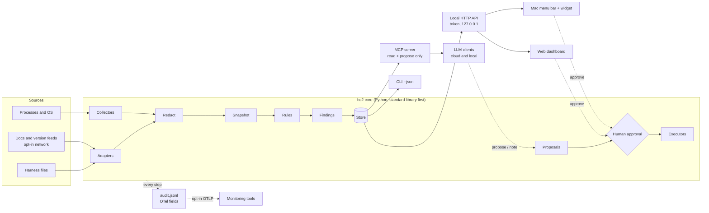

# AI HC2 design

Version 0.1, 30 Oct 2026. Draft. It covers [requirements.md](requirements.md), and the decisions behind it are in [adr/](adr/).

## Shape



## Core components (package `hc2`)

| Module | Job | Notes |
|---|---|---|
| `hc2.model` | Dataclasses: Harness, Install, Session, ProcessNode, SystemSample, Finding, Proposal, Action, Note, Event | Stable ids are hashes of meaning, not of paths. |
| `hc2.adapters.<harness>` | `detect()`, `installs()`, `sessions()`, `process_signatures()`, `docs_sources()`, `latest_version()` (network), `health_inputs()` | One module per harness. A failure is caught and becomes an "unknown" result with a reason. |
| `hc2.collect` | Process trees (`ps`, `lsof`, `ioreg`), system pressure | Never reads environment variables. No sudo. |
| `hc2.redact` | Masks confidential folders, redacts secret-like strings | Runs once, when the snapshot is built. Every surface sees only redacted data. |
| `hc2.rules` | Rule packs: `setup/<harness>`, `resources`, `versions`, `docs`, `cross_harness` | Pure functions: snapshot in, findings out. Thresholds come from config. |
| `hc2.store` | SQLite for history, proposals, approvals, acknowledgements and notes; JSON snapshots | Kept in the state folder, never in the repo. |
| `hc2.audit` | Writes events to `audit.jsonl`; optional OTLP/HTTP exporter | The record format is below. |
| `hc2.actions` | The catalogue; each action has `preview()`, `execute()` and `verify()` | Re-checks a process's identity just before acting. |
| `hc2.api` | Local HTTP: a JSON API, the static web UI, and server-sent events for live updates | Token, Host and Origin checks. |
| `hc2.mcp` | MCP server over stdio | Read tools plus `propose_action` and `add_note`. No approve tool. |
| `hc2.cli` | `hc2 scan, status, sessions, resources, findings, versions, docs, propose, approve, reject, log, doctor, serve, mcp` | Every command has `--json`. `approve` asks for confirmation on a terminal. |

**Web UI.** Plain HTML and CSS, plus small JavaScript modules with no framework or build step. The core serves it.

**Mac app.** Swift menu bar and widget, carried over from AI Harness Health. It talks to the HTTP API (JSON schema 2) instead of running scripts itself. It shows status, top findings and pending approvals, and approves through a native confirmation.

## Files and folders

| What | Where | Notes |
|---|---|---|
| Config | `~/.config/ai-hc2/config.toml` | Confidential folders, thresholds, adapters, retention. |
| Personal extras | `~/.config/ai-hc2/` | Optional `plan.json`, the privacy deny-list. |
| State | `~/.local/state/ai-hc2/` | `hc2.db` (findings history, proposals, approvals, acknowledgements, notes), `audit/YYYY-MM-DD.jsonl`, `snapshots/`, `token`, `api.json` (url, pid, started, schema). `token` and `api.json` are readable only by the user. |

These follow the XDG layout on macOS too, so the paths are the same on every OS. They can be overridden with the `HC2_CONFIG_DIR` and `HC2_STATE_DIR` environment variables.

## Key flows

### 1. Scan
1. A trigger starts the scan: a timer (default 15 minutes), a file watch on harness indexes (watchers never read file contents), or a request.
2. Adapters and collectors run in parallel, each with a timeout.
3. Redaction.
4. Rules.
5. A diff against the previous scan.
6. Store.
7. Events.

### 2. Propose, approve, act
1. A rule, an LLM or a person creates a proposal: the action, its parameters, the reason, the source, and a preview of exactly what will happen.
2. The proposal appears in the web UI, the menu bar and the CLI.
3. A person approves it with a passkey check (Touch ID). The passkey signs the proposal id, the preview hash, a nonce and an expiry. The CLI and the Mac app open the web approve page for this step. One touch can approve several proposals the person has ticked; the passkey then signs the whole list.
4. The core verifies the signature. It refuses the approval if the preview changed, the challenge was used before, or the approval has expired. It stores the assertion with the approval. The batch endpoint is described in [api.md](api.md).
5. The executor re-verifies the stored assertion against the registered passkey. It re-validates the parameters (for example, the process id, start time and command fingerprint still match), runs the action, then checks the result. This way, an approval row inserted straight into the database can't trigger anything.
6. One trace links all of it.

### 3. Docs review
1. `hc2 docs check` fetches the docs index and changelog of each installed harness, from allow-listed hosts.
2. It fingerprints them and compares them with the version each adapter was validated against. A change raises a finding.
3. An LLM client calls the `docs_diff` tool, reads the change alongside the adapter's stated assumptions, and adds a note plus proposals.
4. A person approves.
5. For maintainers that means a PR to HC2. For users it means a local override.

### 4. Several LLMs at once
- Each MCP client session registers a client name and model.
- Notes and proposals are attributed to it.
- Notes on the same finding form a thread, so people can compare analyses side by side.

## Contracts

- **Status and snapshot.** JSON schema 2, versioned. Each harness gets its own section. The endpoints, fields and size limits are in [api.md](api.md).
- **MCP tools.** Versioned, with JSON schemas, and documented in `docs/mcp.md`.
- **Audit record.** One JSON object per line, using OpenTelemetry LogRecord field names. Example:

```json
{"timeUnixNano":"1793350800000000000","severityText":"INFO","eventName":"hc2.action.executed",
 "body":"Stopped orphaned dev server on port 8777 (approved by the user).",
 "traceId":"5b8efff798038103d269b633813fc60c","spanId":"eee19b7ec3c1b174",
 "attributes":{"hc2.schema":"1","hc2.actor.type":"human","hc2.action.kind":"stop_process_tree",
   "hc2.proposal.id":"p_3f2a","hc2.result":"ok"}}
```

  LLM calls and tool calls also carry `gen_ai.*` attributes. Those names are still in development upstream, so HC2 pins their version.

## Security design

- Every listener binds to 127.0.0.1.
- HTTP needs the token from `~/.local/state/ai-hc2/token`, which only the user can read. Host and Origin are checked, and CORS is off.
- The token allows reading and proposing only. Any process running as the user can read it, so approving needs a passkey check that only a person can pass (requirement A-4). That includes acknowledging a finding and changing config through HC2.
- MCP has no approval or execution tools.
- Config changes made outside HC2, and any change to the passkey list, raise a finding on every surface (requirement S-7).
- `audit.jsonl` is hash-chained: each record carries the previous record's hash, so an edit or deletion shows (requirement S-8).
- **Honest scope (requirement S-9).** An agent with a shell can act outside HC2, and HC2 can't prevent that. HC2 itself acts only on a person's verified decision, and tampering with its state is visible.
- The web UI keeps the token in an HttpOnly, SameSite=Strict cookie, never in a URL. Native clients send it as a Bearer header.
- Executors run only catalogued actions. Their parameters are validated twice: once when proposed, and again just before running.
- Redaction happens in the core before anything leaves it. Sentinel tests check this.
- HC2 never reads other processes' environments, keychains or credential files.

## Repo layout

```
ai-hc2/
  src/hc2/            core package
  web/                static web UI
  macos/              Swift menu bar app and widget (moved in at S5)
  tests/              unit, golden, contract, privacy and end-to-end tests; made-up fixtures only
  docs/               requirements, design, slices, threat model, ADRs, harness notes
  examples/           example config
  .github/workflows/  CI, CodeQL, Scorecard, workflow linting
```

## Moving from AI Harness Health

| What | Plan |
|---|---|
| Instruction checks | Ported into the Claude Code rule pack. Golden tests confirm the findings match on fixtures. |
| Sentinel redaction tests, the "watchers never read files" rule, the versioned JSON contract | Kept. The contract moves to schema 2. |
| Personal patterns, config, plan and acknowledgements | Move to `~/.config/ai-hc2/`. Never committed. |
| Bundle id and logging names | Neutral names, no personal identifiers. |
| Finding ids | Change from path-based to meaning-based ids, so they survive file moves. |
