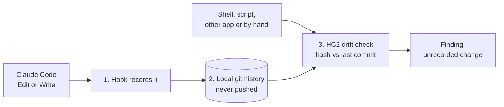

# Instruction-file audit trail

Proposal, 31 Oct 2026. Nothing is built yet. It extends S-7 and FR-6 in [requirements.md](../requirements.md).

## The problem

Instruction files steer every agent session: CLAUDE.md and AGENTS.md at user, folder and project level, skills, hooks and harness settings. Most of them live outside any git repository. When one changes, nothing records who changed it, when, why, or who approved it.

Without such a record, tracing a changed instruction file back to the session that made it means searching session transcripts.

## Goals

- Every change to a listed instruction file leaves a record: when, which file, the content before and after, and which session or person made it.
- A change made with approval says so: it quotes the approval and says where it was given.
- A change with no record shows up as a finding, whoever or whatever made it.

## Non-goals

- **Blocking edits.** This is a record, not a gate.
- **Storing instruction content in HC2.** HC2 keeps hashes and commit ids only (P-1). The content stays in a local git history.
- **Tracking confidential folders** in the shared history (P-2).

## Design: three layers



### 1. Record: a hook on edits

- A PostToolUse hook on Claude Code's Edit and Write tools.
- When the edited path is on the list, it commits that file to the local history. The commit records:
  - the UTC time;
  - the harness, session id and tool;
  - an `Approved:` trailer when the session supplies one.
- It never blocks, and a failure never fails the edit.

**Limit:** it sees only Edit and Write. Changes made through a shell, a script, another harness or by hand skip it. Layer 3 exists for those.

### 2. Keep: a local-only git history

- One git repository whose git folder sits in HC2's state folder and whose work tree is the home folder.
- It tracks only the listed paths, each added by name. It never uses `git add -A`.
- It has no remote and is never pushed.
- Its commits replace ad hoc backup folders.

### 3. Notice: an HC2 drift check

Each scan hashes the listed files and compares each one with its last commit.

| Finding | Severity | When |
|---|---|---|
| Instruction file changed with no record | amber | The file's hash differs from its last commit |
| Recorded change has no approval line | info | A session's commit lacks an `Approved:` trailer |
| Listed instruction file is missing | amber | A listed path no longer exists |

Acknowledging an unrecorded change (a passkey check, A-4) commits it as "Recorded by: owner".

## The approval line

A hook can't see a person's approval: it lives in a conversation. So the session that makes an approved change adds a trailer with:
- the person's words, quoted exactly;
- the session id;
- the UTC time of the approval.

Example, with made-up values:

```
Approved: "add" (session 0000-example, 2026-10-31 20:50 UTC)
```

A fact ledger can hold these as claims with sources later.

## Which files

- **By default:** for each installed harness, the user-level CLAUDE.md, skills, hooks and settings. Claude Code comes first.
- **Added through config:** folder-level instruction files the user names.
- **Confidential folders (P-2)** are excluded. They show as "Confidential A: not tracked".

## Proposed requirement changes

- **S-7:** add "and the listed instruction files (CLAUDE.md, AGENTS.md, skills, hooks, harness settings)".
- **New FR-19, Instruction history (optional):**
  - layers 1 and 2, set up by `hc2 setup instruction-history`;
  - a dry run that lists what would be tracked.
- **FR-6:** the drift findings above.

## Slices

| Slice | Delivers | Done when |
|---|---|---|
| IA1 | The hook and the local history, as a setup command with tests that use a temporary home folder | All four hold: an Edit of a listed file creates a commit with the session id; an Edit of an unlisted file creates nothing; a failing hook doesn't block the edit; the repository has no remote |
| IA2 (inside S3) | The drift findings | Golden tests on fixtures produce each finding, and confidential folders are never hashed |

## Risks

- **A home-folder work tree is easy to misuse:** a broad `git add` would capture everything. Mitigation: setup writes `*` to the repository's `info/exclude` and adds only listed files, by name.
- **Hook cost:** one short process for every Edit or Write.
- **Secrets in settings files:** settings can hold tokens. Mitigations:
  - the history stays local, readable by the user only;
  - each commit runs the privacy gate's secret patterns. A file that matches is not committed, and raises a finding instead.

## Open questions

- Some apps keep their instructions in app settings rather than a file [unverified for each app]. HC2 can fingerprint only what it can read.
- Should a person's own hand edits need an approval line? Proposed: no. Acknowledging the finding records them.
